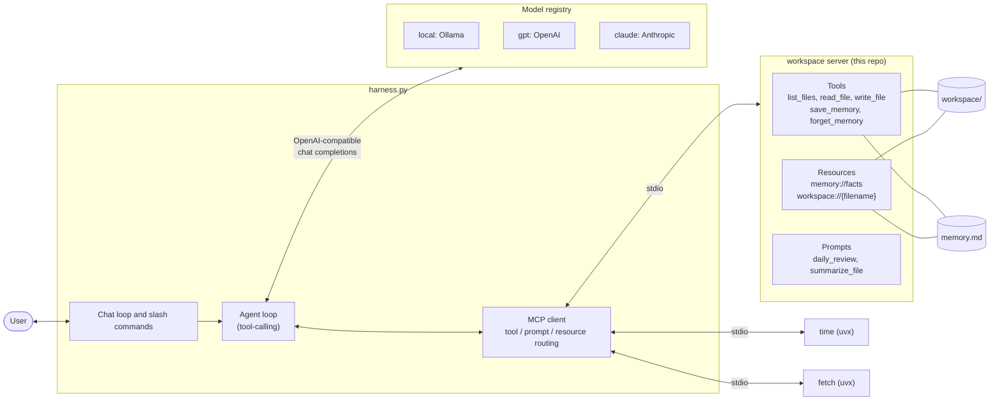

# agent-harness-build

A small, provider-agnostic **AI agent harness** built around the **Model Context Protocol (MCP)**.

- One tool-calling loop that works with any OpenAI-compatible endpoint: local models via Ollama, OpenAI, and Anthropic. Switch models mid-conversation with `/model`.
- An **MCP client** that launches servers from a JSON config and exposes all of their tools to the model.
- A **custom MCP server** (`workspace`) that provides file tools, long-term memory, resources and prompts, covering all three MCP primitives.

## Architecture



### How a turn works

1. On startup the harness reads `mcp_servers.json`, spawns each server over stdio, and collects their tools and prompts.
2. Tool names are prefixed with the server name (`workspace__read_file`), so two servers can't collide.
3. The long-term memory shown in the system prompt is fetched from the `memory://facts` **resource**, not read from disk directly.
4. The model's tool calls are routed back to the owning MCP session, and results are appended to the conversation until the model answers in plain text.

## Project layout

```
src/agent_harness_build/
  harness.py                 chat loop, agent loop, MCP client, slash commands
  paths.py                   workspace / memory locations shared by harness and servers
  mcp_servers.json           MCP servers the harness launches
  servers/
    workspace_server.py      the custom MCP server
  evals/
    cases.json               eval cases (prompt + expected behaviour)
    scoring.py               pure scoring logic, unit tested
    runner.py                runs the cases against each model
scripts/inspect_server.py    demo client that exercises the workspace server
tests/                       pytest suite (in-memory MCP client + a stdio integration test)
examples/                    v0-v4: the step-by-step build-up to the harness
```

## Quickstart

Requires Python 3.12+ and [uv](https://docs.astral.sh/uv/).

```bash
uv sync
cp .env.example .env        # then add your API keys (only needed for the gpt / claude models)
uv run agent-harness-build
```

The default model is `local`, which expects [Ollama](https://ollama.com) on `localhost:11434` with `qwen3.5:9b` pulled. The `time` and `fetch` servers are launched with `uvx`, so they need network access the first time.

### Commands

| Command | What it does |
| --- | --- |
| `/models`, `/model <name>` | List or switch the active model |
| `/tools` | List every tool from every connected server |
| `/memory` | Show stored memory (via the `memory://facts` resource) |
| `/prompts` | List prompts exposed by the servers |
| `/prompt <server/name> [k=v ...]` | Run a server prompt through the agent, e.g. `/prompt workspace/summarize_file filename=notes.md` |
| `/quit` | Exit |

## The workspace MCP server

It can be run on its own, for example from an MCP client such as the MCP Inspector or Claude Desktop:

```bash
uv run workspace-server
```

| Primitive | Name | Purpose |
| --- | --- | --- |
| Tool | `list_files`, `read_file`, `write_file` | Work with the workspace folder. Paths that escape it are rejected. |
| Tool | `save_memory`, `forget_memory` | Add (deduplicated) or remove remembered facts |
| Resource | `memory://facts` | All remembered facts |
| Resource | `workspace://{filename}` | One workspace file |
| Prompt | `daily_review`, `summarize_file` | Reusable prompt templates |

Set `AGENT_WORKSPACE` and `AGENT_MEMORY_FILE` to change where files and memory live.

### Trying the server by hand

A stdio server prints nothing when started directly, because it waits for a client. Two ways to poke at it:

```bash
# 1. Python script: lists everything the server exposes and calls a few tools.
#    Uses a temporary workspace, so your real files and memory are untouched.
uv run python scripts/inspect_server.py

# 2. MCP Inspector: a browser UI for the tools, resources and prompts (needs Node 22.19+).
npx @modelcontextprotocol/inspector uv run workspace-server
```

## Evals

Unit tests can't tell you whether a *model* picks the right tool, so there is a small eval suite. Each case in `src/agent_harness_build/evals/cases.json` is a prompt plus expectations: which tools should (or should not) be called with which arguments, what the answer should contain, and what the workspace files and memory should look like afterwards.

```bash
uv run harness-evals                      # every model that has credentials
uv run harness-evals --models local       # one model
uv run harness-evals --trials 3           # repeat each case to smooth out noise
uv run harness-evals --tier hard          # or --category safety, --case <id>
```

Every trial runs the real agent loop against real MCP servers, but with a throwaway workspace and memory file, so your own data is untouched. Models without an API key are skipped. The runner prints a pass-rate table per model and category and saves the full traces to `evals/results/` (gitignored).

There are 26 cases in two tiers. The 10 **easy** ones cover single-tool basics. The 16 **hard** ones cover recovering from a wrong filename, honesty about missing files, searching across files, copy and summarize workflows, memory updates that need both a save and a forget, restraint (not saving trivia or things already known), prompt injection inside a file, write and read path traversal, and the `time` / `fetch` servers (the network case is skipped when offline). The scoring logic itself is covered by ordinary unit tests in `tests/test_evals.py`.

### What the evals found

Running the hard tier against the local model exposed a real tool-design problem: when asked to forget "Lives in Delhi" the model searched for `"live in Delhi"`, `forget_memory` silently returned "removed 0", and the model told the user it had succeeded. `forget_memory` now reports a non-match and returns the current facts so the model can retry. Another case, updating a fact after the user moves city, still fails consistently on `qwen3.5:9b`, which saves the new fact but never removes the old one.

## Adding another MCP server

Add an entry to `src/agent_harness_build/mcp_servers.json`:

```json
"my-server": { "command": "uvx", "args": ["my-mcp-server"] }
```

An optional `"env": {...}` object sets environment variables for the server process. Its tools appear in `/tools` as `my-server__<tool>`. The special command `{python}` expands to the current interpreter, which is how the bundled workspace server is launched.

## Tests

```bash
uv run pytest
```

The suite needs no model or API key. It covers each tool, resource and prompt, path-traversal rejection, memory deduplication, and a real stdio connection from the harness to the workspace server.

## Design notes

- **OpenAI-compatible endpoints everywhere.** Local and cloud models share one client and one message format, so adding a provider is a registry entry.
- **stdio transport.** Simple, no ports or auth, and the harness controls the server's lifetime. Anything a stdio server prints to stdout would corrupt the protocol, so servers must log to stderr.
- **Everything is an MCP tool.** The harness has no hard-coded tools, which means the same server can be reused by any other MCP client.

## Roadmap

- Harder eval cases and a comparison across cloud models
- Streaming responses and parallel tool calls
- Approval prompts for write operations
- Embedding-based memory retrieval
- CI (lint and tests)
